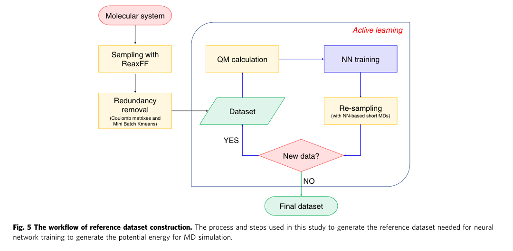

# 用 AI 读懂一篇机器学习势论文

第一次读机器学习势论文，我想弄清楚：**训练用的结构从哪里来，能量和力由谁计算，神经网络学到了什么，作者又怎样验证并做分子动力学？**

这里用 Zeng 等人的甲烷燃烧论文做例子。我先把事先选出的方法原文交给玻尔，看它如何分开 ReaxFF 采样、Gaussian 16 的参考值和两种截断；再把第 6 页的解析文本交给它，问 Fig. 5 的方框和箭头。解析文本里没有图内箭头。对照原图之后，我从 PDF 的矢量路径抽出节点和连线，补进同一道问题，重新检查回答。

论文：Zeng et al., [*Complex reaction processes in combustion unraveled by neural network-based molecular dynamics simulation*](https://doi.org/10.1038/s41467-020-19497-z), *Nature Communications* **11**, 5713 (2020)。[论文全文](materials/source/zeng2020-methane-nn-md.pdf)按 CC BY 4.0 分享，说明见[本案例许可](materials/zeng2020-license.md)。本文页码均为 PDF 页码。

## 这篇论文里的势函数学了什么

这篇论文里的势，学的是原子构型所对应的势能和原子力。构型、参考值、训练、验证和生产模拟是前后相接的几步：

1. **ReaxFF 采样构型。** 第 6 页写，为了提高数据集构建效率，作者用 ReaxFF 反应性分子动力学采样初始数据集。体系在 Materials Studio 的 Amorphous Cell 里建成，含有大量 CH₄ 和 H₂；LAMMPS 使用 NVT 系综，Berendsen 恒温器把温度设为 3000 K，力场是 Chenoweth 等人的 CHO-2008。Open Babel 和深度优先搜索识别每个快照里的物种。每个原子再配上以它为中心、5 Å 以内的物种，成为一个分子簇。初始数据集约有 2250 万个结构。这一步得到的是候选构型。
2. **去掉冗余，并用主动学习补构型。** 2250 万个结构太大，不能逐个做量子化学。第 6 页先按中心原子的成键把初始数据集分成子集，把分子簇写成 Coulomb 矩阵，再取本征谱（eigen-spectrum）做 Mini Batch KMeans，每个簇最多留 10,000 个结构。主动学习接着训练四个神经网络势，并用它们做短分子动力学。第 7 页写：四个模型对同一原子的力彼此不一致，而且模型之间的误差落在 0.5 eV/Å < error < 1.0 eV/Å 时，把对应分子簇加入数据集，直到四个模型的预测始终一致。达到或超过 1.0 eV/Å 时怎样处理，这一段没有写。
3. **Gaussian 16 计算参考能量和力。** 第 7 页写，最终数据集中每个结构的势能和原子力，由 Gaussian 16 在 MN15/6-31G** 水平计算。后面训练要拟合的就是这套参考值。
4. **DeepPot-SE 训练。** 第 7 页把一个结构的总能量写成各原子能量之和；每个原子的能量由它和近邻的位置决定。DeePMD-kit 训练 DeepPot-SE。描述符的截断半径是 6.0 Å，描述符从 1.0 Å 平滑衰减到 6.0 Å。损失同时包含能量误差和力误差。对于能量势，力由势能对原子坐标的负梯度得到；训练完成后，分子动力学用这些力推进原子。
5. **验证，然后做生产模拟。** 第 2 页用同一套 DFT 检查拟合：训练集和测试集的能量 MAE 分别是 0.04 和 0.14 eV/atom；原子力与 DFT 的相关系数是 0.999，MAE 是 0.12 eV/Å。同一页再用一条 NVE 轨迹检查能量守恒，总能量保持守恒。生产模拟是另一条轨迹：周期盒子里 **100 个 CH₄ 和 200 个 O₂**（共 900 个原子），密度 0.25 g/cm³，NVT，Berendsen 恒温器把温度保持在 3000 K，步长 0.1 fs，时长 1 ns。作者选择相对高的密度，并因此称为高压力，同时使用这一高温。

Fig. 5 把其中的构建过程画成循环：数据集进入量子化学计算和神经网络训练，再采样之后如果还有新数据，就回到数据集；没有新数据，才得到最终数据集。方法文字把最终数据集的参考值交给 Gaussian 16，再用这些参考值训练 DeepPot-SE。第 2 页的误差反映模型与参考计算的差距；NVE 轨迹检查能量守恒。1 ns 的 NVT 轨迹则用这个势观察燃烧。

5 Å 和 6 Å 用在不同的步骤：

| 数值 | 在论文中的作用 | 位置 |
| --- | --- | --- |
| 5 Å | 为采样构型中的每个原子构建局部分子簇 | 第 6 页 |
| 6.0 Å | DeepPot-SE 描述符的截断半径，描述符从 1.0 Å 平滑衰减到 6.0 Å | 第 7 页 |
| `0.5 eV/Å < error < 1.0 eV/Å` | 四个模型对同一原子力的分歧落在这个开区间时，把对应分子簇加入数据集 | 第 7 页 |
| 0.12 eV/Å | 训练后的势所预测的原子力相对 DFT 的 MAE | 第 2 页 |

采样用的模型燃烧体系在第 6 页写成大量 CH₄ 和 H₂。已经跑完并用来分析反应的，是第 2 页那个 3000 K、0.25 g/cm³ 的 CH₄/O₂ 盒子。如果要看的是约 1 atm、低于 2000 K 的稀释甲烷—空气火焰，正文给出的生产条件是上面这一条高温、高密度轨迹；压力的 atm 或 Pa 数值没有写出。

## 用玻尔拆解论文的方法

方法问答的输入，是事先选出的第 6、7 页原文片段，写在[提问](bohrium-pass/zeng-pipeline-prompt.txt)里。这些片段对应[原块](bohrium-pass/zeng-parser-key-blocks.json)的页码和顺序。块号里的 a、b 是对同一原块选段的标记：P6-13a 和 P6-13b 摘自第 6 页顺序为 13 的段落，P7-10a 和 P7-10b 摘自第 7 页顺序为 10 的段落。提问要求只依据这些块，分四行说明 ReaxFF 的作用、能量和力的参考值、5 Å 和 6 Å，并标上块号。

实际返回模型是 `chenkun/gpt-5-nano`，见[调用记录](bohrium-pass/zeng-pipeline-metadata.json)和[完整返回](bohrium-pass/zeng-pipeline-response-public.json)。[回答](bohrium-pass/zeng-pipeline-answer.txt)把参考值写成：“最终数据集中每个结构的势能和原子力通过 Gaussian 16 软件在 MN15/6-31G** 水平计算。”同一回答把 6 Å 写成：“截断半径设为 6.0 Å，描述子在 1.0 到 6.0 Å 间平滑衰减。”回答里的“描述子”就是上文的描述符。它的 5 Å 那一行对应 P6-13b，说这个截断用于构建以该原子为中心、包含周围物种的分子簇。P7-8 是第 7 页顺序为 8 的段落里、Gaussian 16 那一句。四行分别落在采样、参考值和两种截断上。

Fig. 5 的阅读用的是另一组已经保存的材料。第一次只给了[第 6 页解析文本](bohrium-pass/zeng-parser-retest-page6.txt)。文本里有图注和方法文字，没有方框名称和箭头。问题是：列出图中每个方框的名称及箭头顺序，并给出依据。

[基础回答](bohrium-pass/zeng-figure-baseline-answer.txt)写：“由于原文未直接给出 Fig. 5 的每个方框标签，以下名称为依据文本描述所推断的对应流程”。它按方法文字列出 16 个步骤，里面有 Amorphous Cell、LAMMPS 和聚类。这些是正文中的操作，对不上图里的九个方框。实际模型是 `chenkun/gpt-5-nano`，见[两次文本问答的记录](bohrium-pass/zeng-figure-comparison-metadata.json)。

同一段文本、同一个问题后面加了一句核验要求，原文在[指令](bohrium-pass/zeng-figure-guarded-instruction.txt)。[回答](bohrium-pass/zeng-figure-guarded-answer.txt)先写：“在你提供的文本中，Fig. 5 的图像本身并未显示方框的名称和箭头的具体顺序。”接着仍按方法文字整理出 8 个步骤，并标明这些是推断。只有这段解析文本时，两次回答都讲到了采样和聚类，也都不能当作图中方框和箭头的转录。

## 回到原文核对关键解释



*Zeng 等人 Fig. 5 裁图，许可见[本案例许可](materials/zeng2020-license.md)。*

对照原图，主线是：

```text
Molecular system → Sampling with ReaxFF → Redundancy removal → Dataset
Dataset → QM calculation → NN training → Re-sampling → New data?
New data? ──YES──→ Dataset        继续循环
New data? ──NO───→ Final dataset  结束
```

Active learning 是包围这条循环的区域名称。YES 和 NO 是分支标记。只有解析文本的两次回答没有给出这条主线。

第一次补充给模型的，是同一 PDF 图内文字层的词和坐标，见[词表](bohrium-pass/zeng-figure-text-layer-words.txt)和[记录](bohrium-pass/zeng-figure-text-layer-metadata.json)。材料里没有箭头路径。实际模型仍是 `chenkun/gpt-5-nano`。[回答](bohrium-pass/zeng-figure-text-layer-answer.txt)找到了多个标签，并把顺序写成：“初步推断的箭头顺序为：Molecular system -> Sampling with ReaxFF -> Redundancy removal -> QM calculation -> NN training -> Re-sampling -> Active learning -> New data? -> Final dataset”。对照原图，Redundancy removal 的下一框是 Dataset；Active learning 被排进了这条直线。YES、NO 的指向，这份回答留待看原图。

第二次补充把已经提取的节点、箭头和 YES／NO 写进同一道基础问题，补充文本在[矢量材料](bohrium-pass/zeng-figure-vector-supplement.txt)。节点和九条箭头就在材料里，模型据此组织顺序。两次调用的接口都是 `gpt-5-nano`，返回模型都是 `chenkun/gpt-5-nano`，见[记录](bohrium-pass/zeng-figure-vector-metadata.json)。[运行 1](bohrium-pass/zeng-figure-vector-answer-1.txt)和[运行 2](bohrium-pass/zeng-figure-vector-answer-2.txt)都列出九个节点、九条箭头，YES 回到 Dataset，NO 指向 Final dataset。

图的连线对上之后，方法解释还要回到原文。[逐项核对](bohrium-pass/zeng-figure-vector-review.md)记下了这些偏差。运行 1 把聚类用的“特征（特征谱/特征向量）”并列为近义表述；第 6 页写的是由特征值问题得到的 eigen-spectrum。运行 2 写“聚类并抽样得到的子集形成初始数据集”；第 6 页先把约 2250 万个采样结构称为初始数据集，图中的 Dataset 是去冗余之后进入循环的数据集。运行 1 把 QM 计算写成获得“高水平数据”，运行 2 写成“高精度参考数据”；两次都没有在这一环节写出参考值是能量和力，能量和力写在第 7 页。

节点和箭头由[提取脚本](bohrium-pass/extract_fig5_graph.py)从这份 PDF 读出。它在 Fig. 5 的页面区域内找填充形状，用落在形状里的文字确定节点；箭头端部的小三角形给出方向，尖端靠近哪个节点，箭头就指向哪里。YES、NO 按邻近位置连到从 New data? 出发的箭头上。形状或方向有歧义时，脚本报错，不自动补边。[抽出的节点和九条边](bohrium-pass/zeng-figure-vector-graph.json)已经按[运行前核对过的原图](bohrium-pass/zeng-figure-vector-protocol.md)逐条对过。脚本里的区域和尺寸阈值是按这一张图定的，适用于带文字层和矢量路径的这份 PDF。扫描页，或整张图已经变成图片的论文，需要先用别的方式读取图形。

## Skill 带来了哪些变化

我把“解释方法、对照原文、再判断用途”写成 [method-fit-check](skill/SKILL.md)。同一篇 Zeng 论文、同一个[任务](examples/zeng-v5/cases/A/task.md)，各跑两次有 Skill、两次无 Skill。调用参数都是 `grok-4.7-high`，程序是 Cursor agent CLI `2026.10.19-6bbf2c4`。[验收标准](examples/zeng-v5/cases/A/acceptance.md)写于 v4 运行前，v5 沿用同一文件；四次记录的任务、验收、PDF 哈希与这些文件一致，有 Skill 的两次还带上同一份 Skill 哈希。

| 运行 | 对论文未明确说明的信息如何处理 | 耗时 |
| --- | --- | ---: |
| [有 Skill 1](examples/zeng-v5/A-with-1/answer.md) | 训练集元素范围和压力数值标为未说明 | 625.5 s |
| [无 Skill 1](examples/zeng-v5/A-without-1/answer.md) | 将训练集写成确定的 C/H/O，并另做压力估算 | 363.2 s |
| [有 Skill 2](examples/zeng-v5/A-with-2/answer.md) | 将惰性气体适用性留待验证，压力数值标为未说明 | 609.9 s |
| [无 Skill 2](examples/zeng-v5/A-without-2/answer.md) | 将参考集写成确定没有惰性气体，并估算密度和比例 | 412.0 s |

四份回答都解释了主要方法，并判断论文没有展示目标火焰条件。有 Skill 的两次更谨慎地处理了训练集元素范围，也都更慢。四次传入的模型 ID 相同，但有 Skill 的初始化显示名带 `256K`，无 Skill 的没有。服务未公开权重版本，因此不能排除后端配置差异；四份运行记录中的费用均为“无法取得”。[初始化记录](docs/reproduction.md#模型和费用)和完整结果可供核查。

无 Skill 1 把论文的密度和温度用于压力估算。[回答](examples/zeng-v5/A-without-1/answer.md)假设初始的 100 个 CH₄ 和 200 个 O₂ 尚未反应，并把它们当作理想气体，得到约 2.31 × 10³ atm；回答同时注明论文没有报告这一数值。

用相同假设和常数，[独立复算](bohrium-pass/estimate_initial_ideal_pressure.py)得到平均摩尔质量 26.679 g/mol，代入 P = ρRT/M 后约为 2,307 atm，与模型的算术结果一致。[论文](materials/source/zeng2020-methane-nn-md.pdf)第 2 页只给出初始组成、0.25 g/cm³、3000 K，并说明密度较高、因而压力较高。原[任务](examples/zeng-v5/cases/A/task.md)只要求依据论文，模型额外引入了理想气体假设；这个估算值不是论文报告的压力，也不能直接当作反应轨迹的实际压力。

后来又做了一组独立配对：[任务](examples/zeng-v5/cases/A/task-compact.md)比前四次多了一条双方共用的篇幅要求，要求尽量写成 800—1200 字，因此单独比较。这组使用同一篇论文、[验收标准](examples/zeng-v5/cases/A/acceptance.md)、账号和 `grok-4.7-high`；只有有 Skill 的一侧加载 v5。

两份回答都解释了采样、参考计算和训练，也都判断论文没有展示目标火焰条件。对照论文第 6—7 页，正文没有列出最终参考集的完整元素范围；这一点上两份回答不同：

| 运行 | 对参考集元素范围的说明 | 耗时 |
| --- | --- | ---: |
| [有 Skill](examples/zeng-v5/A-compact-with/answer.md) | 把参考结构是否含氮或惰性气体列为未说明 | 510.3 s |
| [无 Skill](examples/zeng-v5/A-compact-without/answer.md) | 将量子化学与 ReaxFF 采样都写成 C、H、O 体系 | 435.2 s |

有 Skill 的回答也有页码标注过宽的地方：它在标为第 6—7 页的证据段中提到的误差数值，实际在第 2 页。两侧初始化均显示 `Grok 4.7 256K High`（[有 Skill](examples/zeng-v5/A-compact-with/run-init.json)、[无 Skill](examples/zeng-v5/A-compact-without/run-init.json)），后台权重未公开；两次运行记录（[有 Skill](examples/zeng-v5/A-compact-with/meta.json)、[无 Skill](examples/zeng-v5/A-compact-without/meta.json)）没有单次费用。无 Skill 运行曾把论文页面图和草稿写入并读出系统临时目录，偏离了任务里的目录限制；这些文件已清理。

重跑前可以先做预检。预检只打印输入哈希，不启动模型；命令、显示名和费用的出处写在[复现说明](docs/reproduction.md)。

## 在自己的论文上复用

换一篇论文时，把下面三段括号换成自己的题名、问题和目标，再附上你实际交给模型的原文。提问要求把方法步骤、原文证据和适用条件分开：

```text
我在读【论文题名、年份和出处】。想弄清的问题是：【用一句话写下你的问题】。我的目标用途是：【体系、温度、压力或密度、组成】。

请只根据我附上的原文，用中文分三部分回答。

方法步骤：按论文实际顺序写出每一步。每一步说明输入、做了什么、输出是什么。构型从哪里来、参考能量和力由谁计算、模型学什么、作者怎样验证、最后做了哪一次模拟，分开写。同名参数如果用在不同步骤，分别说明它的数值、单位和对象。

原文证据：每个关键事实注明页码、图号或表号。能对应到原句的，用短句点出原句在说什么。原文没有写出的数值、物种或条件，标成“未说明”。

适用条件：先列出论文已经验证和已经模拟的体系、温度、密度或压力、组成和时间。再对照我的目标，指出现有结果能回答哪一部分，哪一部分还没有这篇论文里的证据。

如果我给的是流程图，先看材料里有没有图内方框和箭头。只有图注或正文、没有连线时，直接说明连线不在材料里；正文中的步骤不要写成图上的标注。
```

本例已经保存的 Fig. 5，可以从仓库里的第 6 页解析文本走完“提取原图结构、重建提问、玻尔问答”。图结构从论文 PDF 重新提取。保存这些结果时使用 Python 3.12.8、PyMuPDF 1.26.7，也曾在 Python 3.11.14 下得到同样的图结构；Bohr CLI 为 2.9.21，Node.js 为 24.11.1。复跑需要 Windows、Python、Node.js、已登录的 Bohr CLI，以及能调用 `gpt-5-nano` 的账号。

在仓库根目录运行：

```powershell
python -m pip install PyMuPDF==1.26.7
npm install -g @dptech-corp/bohr-cli@2.9.21
bohr auth login

python bohrium-pass/extract_fig5_graph.py --pdf materials/source/zeng2020-methane-nn-md.pdf --out ./figure-run
python bohrium-pass/build_figure_question.py --mode baseline --out ./figure-run/baseline.txt
python bohrium-pass/build_vector_prompt.py --baseline ./figure-run/baseline.txt --graph ./figure-run/graph.json --out ./figure-run

$BohrEntry = Join-Path ((npm root -g).Trim()) '@dptech-corp/bohr-cli/run.js'
$FigureQuestion = Get-Content -Raw -Encoding utf8 './figure-run/vector-prompt.txt'
node $BohrEntry chat $FigureQuestion --model gpt-5-nano --output json
```

不带 `--result-dir` 的提问命令读取已保存的[第 6 页文本](bohrium-pass/zeng-parser-retest-page6.txt)。`graph.json` 应列出 9 个节点和 9 条箭头，YES 从 New data? 回到 Dataset，NO 指向 Final dataset。回答再对照原图和[运行前写好的验收标准](bohrium-pass/zeng-figure-vector-protocol.md)。上面最后一条命令会重新调用模型；仓库里的[运行 1](bohrium-pass/zeng-figure-vector-answer-1.txt)和[运行 2](bohrium-pass/zeng-figure-vector-answer-2.txt)是已经保存的两次回答，重跑后的表述可以不同。

新的解析怎样进入提问、单页和从 0 起的页索引、轮询、本地检查、空白图、Skill 预检，以及各次模型和费用，写在[复现说明](docs/reproduction.md)。Fig. 5 的提取脚本只适用于这一张带矢量路径的图。

## 论文与运行记录

| 内容 | 位置 |
| --- | --- |
| 论文全文与授权 | [Zeng 2020 PDF](materials/source/zeng2020-methane-nn-md.pdf)、[本案例许可](materials/zeng2020-license.md) |
| 方法原文与四行问答 | [选出的原块](bohrium-pass/zeng-parser-key-blocks.json)、[提问](bohrium-pass/zeng-pipeline-prompt.txt)、[回答](bohrium-pass/zeng-pipeline-answer.txt)、[模型记录](bohrium-pass/zeng-pipeline-metadata.json)、[完整返回](bohrium-pass/zeng-pipeline-response-public.json) |
| 第 6 页文本与只有文本时的问答 | [第 6 页返回文本](bohrium-pass/zeng-parser-retest-page6.txt)、[基础回答](bohrium-pass/zeng-figure-baseline-answer.txt)、[核验指令](bohrium-pass/zeng-figure-guarded-instruction.txt)、[核验后的回答](bohrium-pass/zeng-figure-guarded-answer.txt) |
| 两次补充、原图与核查 | [图内文字](bohrium-pass/zeng-figure-text-layer-words.txt)、[文字层回答](bohrium-pass/zeng-figure-text-layer-answer.txt)、[矢量补充](bohrium-pass/zeng-figure-vector-supplement.txt)、[运行 1](bohrium-pass/zeng-figure-vector-answer-1.txt)、[运行 2](bohrium-pass/zeng-figure-vector-answer-2.txt)、[原图裁图](materials/excerpts/zeng2020-fig5.png)、[核查](bohrium-pass/zeng-figure-vector-review.md) |
| 复现命令与检查 | [提问脚本](bohrium-pass/build_figure_question.py)、[图结构脚本](bohrium-pass/extract_fig5_graph.py)、[矢量提问脚本](bohrium-pass/build_vector_prompt.py)、[复现说明](docs/reproduction.md) |
| Skill A 对照 | [任务](examples/zeng-v5/cases/A/task.md)、[验收标准](examples/zeng-v5/cases/A/acceptance.md)、[案例 A 复现脚本](examples/zeng-v5/reproduce_a.py)、[有 Skill 1 的记录](examples/zeng-v5/A-with-1/meta.json)、[无 Skill 1 的记录](examples/zeng-v5/A-without-1/meta.json) |
| 初始压力的独立复算 | [估算脚本](bohrium-pass/estimate_initial_ideal_pressure.py)、[无 Skill 1 的回答](examples/zeng-v5/A-without-1/answer.md) |

论文和已有软件归原作者所有。本项目整理了阅读问题、图结构提取、提示、核查记录和 Skill 对照。
