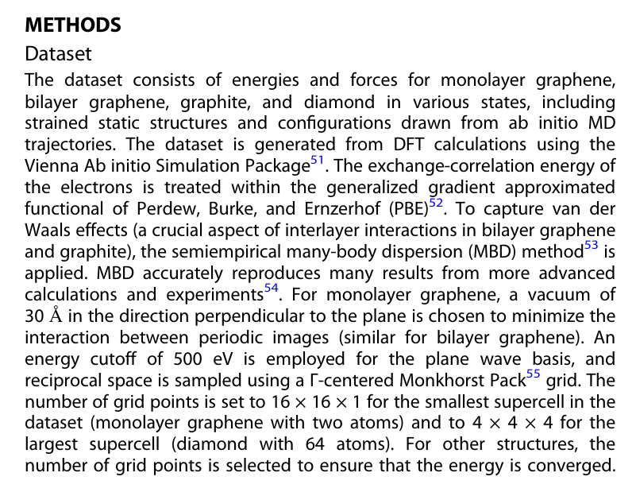

# Wen 2020：数据集说明（PDF 第 8 页）

Mingjian Wen and Ellad B. Tadmor, “Uncertainty quantification in molecular simulations with dropout neural network potentials,” *npj Computational Materials* 6, 124 (2020), [DOI 10.1038/s41524-020-00390-8](https://doi.org/10.1038/s41524-020-00390-8)。出版方 PDF 第 10 页注明 [CC BY 4.0](https://creativecommons.org/licenses/by/4.0/)；下图从原 PDF 第 8 页的 Methods / Dataset 裁出。

原文将单层石墨烯、双层石墨烯、石墨和金刚石的能量与力列为数据集内容；数据包含应变静态结构及从头算 MD 构型，参考值来自 DFT 计算。

